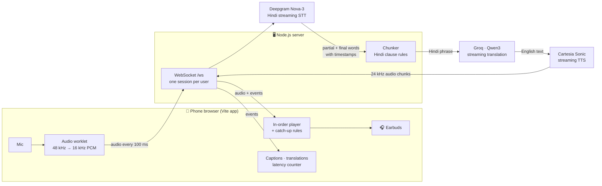

# Bolo: Project Overview

> **Speak Hindi. Hear English.** A live voice interpreter that speaks the English translation in your earbuds about 1–2 seconds after you finish each phrase, while you keep talking.

Built for the **Bolna Buildathon** (Symphony 2026).
This document covers what the project is, how it is built, what is done, and what comes next. For setup commands, see [README.md](README.md).

---

## 1. The hackathon

| | |
|---|---|
| **Event** | [Buildathon by Bolna](https://www.bolna.ai/symphony/buildathon), held alongside Symphony 2026, Bolna's Voice AI summit in Bengaluru |
| **Rule** | Build anything, as long as it has a voice component. No tracks. |
| **Format** | Fully virtual until the finale |
| **Submission deadline** | **Oct 31, 2026** (no time or timezone stated, so submit early) |
| **After submission** | Shortlist emails Nov 3 → interviews Nov 5–7 → finalists Nov 8 → finale pitch Nov 20 at The Lalit Ashok, Bengaluru |
| **Prizes** | 1st ₹50,000 + YC interview · 2nd ₹40,000 · 3rd ₹30,000 · top 3 travel covered · top 10 get Symphony tickets |
| **Sponsors** | Plivo, Sarvam, Cartesia, Deepgram, Kalpa Labs |
| **Submit form** | [buildathon.bolna-ai.lovable.app/symphony/buildathon/submit](https://buildathon.bolna-ai.lovable.app/symphony/buildathon/submit) |

**The submit form asks for:** team size, name, email (the same one you registered with), project name, a description of up to 200 characters, a submission link (repo, live app or demo), and a pitch video or deck link (Google Drive or Luma, shared as "Anyone with the link").

**Why this project fits:** voice is the whole product, it uses three sponsors (Deepgram, Cartesia, Sarvam), and a live latency counter makes the demo easy to believe.

---

## 2. What Bolo does

1. Open the web app on a phone and put in earbuds.
2. Tap **Start** and speak Hindi (or Hinglish).
3. Hindi captions appear live as you speak.
4. About 1–2 seconds after each phrase ends, an English voice speaks the translation. You never have to pause and wait.
5. A big **Delay** counter shows how long each translation took to start playing, plus the running average.

**Who it's for:**
- Travellers and migrants talking with people who don't share a language.
- Field workers, drivers, clinics and help desks serving Hindi speakers.
- Anyone on a call with someone who speaks a different language. That's the next step for this project.

---

## 3. Architecture

### High-level flow



### Step by step

| # | Stage | Where | What happens | Typical time |
|---|---|---|---|---|
| 1 | **Capture** | Browser (`client/public/pcm-worklet.js`) | The mic, with echo cancellation and noise suppression on, is converted to 16 kHz mono and sent every 100 ms | — |
| 2 | **Speech to text** | Deepgram `nova-3`, `language=hi` | Streams partial Hindi words while you talk, then final words with timestamps. 300 ms of silence ends a phrase. | 0.5–1.0 s after the phrase ends |
| 3 | **Chunking** | `server/chunker.js` | Decides when a piece of Hindi is complete enough to translate (see §4) | instant |
| 4 | **Translation** | Groq `qwen/qwen3.8-27b` | Streams natural English, using the last 6 phrases as context | ~100 ms to first word |
| 5 | **Text to speech** | Cartesia `sonic-2` | One open connection per session; streams 24 kHz audio | ~105 ms to first audio |
| 6 | **Playback** | Browser (`client/src/main.js`) | Plays phrases strictly in order, starting each as soon as its first audio arrives. Speeds up or skips if it falls behind (see §5). | — |

### Fallbacks

- **Translation:** if Qwen fails or times out (4 s), it tries `openai/gpt-oss-20b`, then **Sarvam Translate**.
- **Speech to text:** if Deepgram drops, the server reconnects by itself and buffers up to 5 s of audio, keeping timestamps on one continuous timeline.
- **Phone network:** if the connection drops, the app reconnects with growing delays (0.4 s → 5 s) and also retries as soon as the phone comes back online.
- **Voice output:** if Cartesia fails or times out, that phrase is marked finished so playback never gets stuck.

### Streaming API (`wss://<host>/ws`)

| Direction | Message | Meaning |
|---|---|---|
| Client → server | binary | 16 kHz mono PCM16 mic audio, ~100 ms per frame |
| Client → server | `{"type":"flush"}` | Translate whatever was heard so far (sent on Stop) |
| Server → client | `ready` | Session open |
| Server → client | `transcript` `{text, isFinal}` | Live Hindi captions |
| Server → client | `segment` `{seg, hi, speechEnd, reason}` | A phrase was sent for translation |
| Server → client | `translation` / `translation_done` | Streamed English text |
| Server → client | `metrics` `{sttMs, translateMs, ttsMs, serverMs}` | Time spent in each stage |
| Server → client | binary `[uint32 seg][PCM16 24 kHz]` | English audio for phrase `seg` |
| Server → client | `tts_done` `{seg}` | No more audio for that phrase |

### How the delay is measured

**Delay = when the English audio starts playing − when the speaker finished saying that phrase.**

The browser records the moment each 100 ms of mic audio was captured. Deepgram returns the timestamp at which the phrase ended in the audio, the browser converts that back to a real time, and when the English starts playing it takes the difference. That gives an end-to-end "mouth to ear" number that includes network delay and waiting in the playback queue, not just server time.

---

## 4. The hard problem: Hindi word order

Hindi puts the verb last:

> मैं कल बाज़ार जाऊँगा → literally *"I tomorrow market will-go"*

- **Translating word by word** produces broken English, and words like **कल** (*yesterday* or *tomorrow*) can't be resolved until the verb arrives.
- **Waiting for the full sentence** adds several seconds of delay.

**Bolo's approach: commit at Hindi clause boundaries.**

1. **Stable-text rule.** The last 2 words of every partial transcript are ignored, because they still change as more audio arrives.
2. **Clause-end detection.** A phrase is committed when the stable text reaches one of these:
   - punctuation from the recognizer: `। . ? ! ,`
   - a clause-final verb or helper word: `है, हैं, था, थी, थे, चाहिए`, or a future form like `जाऊँगा / करेंगे`
   - **but not** when more verb parts follow: `गया है`, `कर सकते हैं`
   - the point just **before** a conjunction: `और, लेकिन, क्योंकि, तो, अगर, वरना…`, so each clause keeps its own verb (and a chunk never ends on "और")
   - silence (300 ms endpointing), or a hard cap of 8 words so a long clause never stalls
3. **Context-aware translation.** The model sees earlier phrases and is told to continue the English naturally, never repeat, never invent, and to read **कल** from the verb tense.

**Example from the test run:**

| Hindi chunk | Why it was committed | English |
|---|---|---|
| कल की meeting cancel हो गई | clause end, before "क्योंकि" | Yesterday's meeting got canceled |
| क्योंकि client की flight delay थी | silence | because the client's flight was delayed |

---

## 5. Keeping up with a fast speaker

English often takes longer to say than Hindi, so audio can queue up during a long monologue. The rules live in `client/src/playback-policy.js`, which the test runner also uses, so test numbers match real playback.

| English waiting in the queue | What the player does |
|---|---|
| under 1.5 s | normal speed |
| over 1.5 s | plays at **1.12×** |
| over 3 s | plays at **1.25×** |
| over 6 s | **drops the stale queue** and jumps to the newest phrase (shown struck through in the UI) |

**Stopping the app from translating itself:**
- **Earbuds mode:** the mic stays on all the time, relying on the browser's echo cancellation.
- **Speaker mode:** the mic is muted while English is playing. The app sends silence instead of nothing, so timestamps stay correct.

---

## 6. What we have built

### Done ✅

| Area | Status |
|---|---|
| Hackathon research (rules, deadline, form fields, sponsors) | ✅ |
| API keys verified (Deepgram, Groq, Cartesia, Sarvam) | ✅ |
| Provider comparison: Qwen on Groq was fastest at ~80 ms to the first translated word | ✅ |
| 10 Hindi test clips (5 short, 3 long, 2 Hinglish), generated with Sarvam Bulbul v3 | ✅ |
| WebSocket server with streaming STT → chunker → translation → TTS | ✅ |
| Hindi clause-aware chunker + 4 unit tests | ✅ |
| Translation fallbacks (Qwen → gpt-oss → Sarvam) | ✅ |
| Connections opened early, so the first phrase isn't slow | ✅ |
| Mobile-first web app on **Vite**: live captions, per-phrase translations, delay counter, average, per-stage breakdown | ✅ |
| In-order audio playback with speed-up and skip catch-up rules | ✅ |
| Earbuds / Speaker mode (mic mutes while playing) | ✅ |
| Auto-reconnect (browser ↔ server and server ↔ Deepgram), heartbeats, screen wake lock | ✅ |
| "Play sample clips" demo mode (no mic or Hindi speaker needed) | ✅ |
| Test runner that streams clips in real time and reports delay per phrase | ✅ |
| README, `.env.example`, `.gitignore` (keys never committed), `render.yaml` for one-click deploy | ✅ |

### Measured results

| Test | Phrases | Average | Median | Worst |
|---|---|---|---|---|
| 10 clips, test runner | 17 | **1.33 s** | 1.25 s | 2.52 s |
| 10 clips, real browser | 17 | **1.56 s** | 1.45 s | 2.70 s |
| 90 s nonstop monologue | 34 | **1.71 s** | 1.72 s | 3.76 s |

- Short sentences: **0.8–1.2 s**, beating the 1–1.5 s goal.
- Long sentences are split into clauses that each land in **1–2.5 s**, within the under-3 s goal.
- **The delay doesn't pile up:** in the 90 s monologue the second half averaged 1.55 s vs 1.87 s for the first.
- **Where the time goes:** speech recognition 0.5–1.0 s (most of it), translation ~0.1 s, voice ~0.1 s.

### Known limitations

- Speech recognition is the slowest step, so lowering endpointing below 300 ms is the next latency lever.
- The test clips are synthetic voices. Recognition sometimes mishears a word (e.g. दादी → "दबी"), so translation is only as good as the transcript.
- Speeding playback up to 1.12×/1.25× raises the pitch slightly.
- Not yet tested on a real phone, on mobile data, or outdoors.
- One direction only (Hindi → English).

---

## 7. How to test

### On the laptop

```bash
npm run dev            # API server on :3000 + Vite page on :5173
```

Open **http://localhost:5173**, then:
- Click **"Play sample clips instead"** to watch the full pipeline without speaking.
- Or put on earphones, click **Start** and speak Hindi.

### Automated (server must be running)

```bash
npm run test:unit                          # Hindi chunking rules
npm run test:clips                         # 10 clips, translation + delay table
node tools/run-clip.mjs --all --loops 2    # 90 s monologue, checks delay doesn't pile up
```

### On a phone (needs https for the mic)

```bash
npm run build
npm start                                          # serves app + API on :3000
cloudflared tunnel --url http://localhost:3000     # gives an https link
```

Open the link on the phone, put in earbuds, tap **Start**, and check each of these:
- [ ] Delay stays around 1–2 s
- [ ] Works on mobile data, not just Wi-Fi
- [ ] Recovers by itself after a few seconds of airplane mode
- [ ] Works outdoors or somewhere noisy
- [ ] The mic doesn't translate the English voice (try Speaker mode without earbuds)
- [ ] 5 minutes of walking and talking stays stable

---

## 8. What we can do next

### Before submitting (today, must do)

| # | Task | Why |
|---|---|---|
| 1 | Commit and push to a **GitHub** repo | The submission link |
| 2 | **Deploy on Render** (`render.yaml` is ready) | A permanent https link for judges and phones |
| 3 | **Phone test** with earbuds on mobile data | Proves it works in real conditions; the plan says never cut this |
| 4 | Record a **1–2 min demo video**: a real Hindi speaker, a real English listener, delay counter visible | Required pitch video link |
| 5 | **Submit** the form and open every link in a private window | Confirms it loads for someone else |

**Suggested description (under 200 characters):**
> Bolo: speak Hindi, hear natural English in your earbuds ~1.5 s later. Live streaming STT → LLM → TTS with Hindi clause-aware chunking and a live latency counter.

### Quick wins (an hour or less each)

- **Tune latency:** try 200–250 ms endpointing and `sonic-turbo` for voice, and re-run `test:clips` to compare.
- **Voice picker:** let the listener choose the English voice (Cartesia has many).
- **Test with real voices:** record your own 10 clips into `test_clips/` (same file names).
- **Latency chart:** a small graph of delay per phrase, for the demo video.
- **QR code** on the desktop page so judges can open it on their phone instantly.

### Bigger features (for the finale, Nov 20)

| Feature | Payoff | Effort | Notes |
|---|---|---|---|
| **Two-way mode** | Both people speak and each hears their own language | Medium | Add English → Hindi (Deepgram English STT, Sarvam Bulbul or Cartesia Hindi voice), with a speaker toggle or one phone per person |
| **Phone call translation** | Real calls between two languages, which is Bolna's core business | Medium–high | Use **Bolna** agents or **Plivo** telephony to bridge two callers through the pipeline; a strong fit for the hosts and sponsors |
| **Voice cloning** | The English sounds like *you* | Medium | Cartesia voice cloning from a short sample; watch that it doesn't add delay |
| **Sarvam streaming STT** | Better on Indian accents and Hinglish | Medium | Compare against Deepgram with real recordings; Sarvam can also translate speech straight to English |
| **More languages** | Tamil, Telugu, Marathi, Bengali → English | Low–medium | Recognition and translation already support them; the chunker needs clause rules per language |
| **Provider fallback dashboard** | Shows reliability to judges | Low–medium | Live view of which provider handled each phrase and the delay per stage |
| **Speaker-adaptive chunking** | Lower delay for fast speakers, better English for slow ones | Medium | Adjust the word window to the speaker's pace |
| **Better catch-up** | No pitch change when speeding up | Low–medium | Ask Cartesia to speak faster instead of speeding up playback in the browser |

### If we fall behind, cut in this order

Voice cloning → two-way mode → dashboard.
**Never cut** the latency counter or the phone test, because they're what make the demo convincing.

---

## 9. Project layout

```
bolna/
├── server/                    Node.js API (≈ 770 lines)
│   ├── index.js               HTTP + WebSocket server, serves dist/ in production
│   ├── session.js             one live session: STT → chunker → translate → TTS
│   ├── chunker.js             Hindi clause-boundary rules  (+ chunker.test.js)
│   ├── stt.js                 Deepgram streaming client, auto-reconnect
│   ├── translator.js          Groq streaming translation + fallbacks
│   ├── tts.js                 Cartesia streaming voice
│   └── config.js              every setting, all overridable by env vars
├── client/                    Vite frontend (plain JavaScript)
│   ├── index.html
│   ├── src/main.js            mic, connection, playback, latency counter
│   ├── src/playback-policy.js catch-up rules (shared with the test runner)
│   ├── src/style.css
│   └── public/pcm-worklet.js  mic resampler (runs on the audio thread)
├── tools/
│   ├── run-clip.mjs           streams clips in real time, prints delay table
│   └── make-clips.mjs         generates Hindi test clips with Sarvam
├── test_clips/                10 Hindi/Hinglish WAVs + expected English
├── vite.config.js · render.yaml · package.json · .env.example
└── README.md · PROJECT.md
```

### Tech stack

| Layer | Choice | Why |
|---|---|---|
| Server | Node.js 22, Express, `ws` | One language end to end; streaming connections are natural in Node |
| Frontend | Vite, plain JS, Web Audio API, AudioWorklet | Tiny bundle (~8 KB JS), fast on phones, no framework overhead |
| Speech to text | Deepgram Nova-3 (Hindi) | Streaming partials with word timestamps; sponsor |
| Translation | Groq · Qwen3 27B | ~80–100 ms to first token |
| Text to speech | Cartesia Sonic 2 | ~100 ms to first audio, natural voice; sponsor |
| Backup / test clips | Sarvam Translate, Bulbul v3 | Strong on Indian languages; sponsor |
| Hosting | Render (free tier) | One-click deploy from `render.yaml` |
